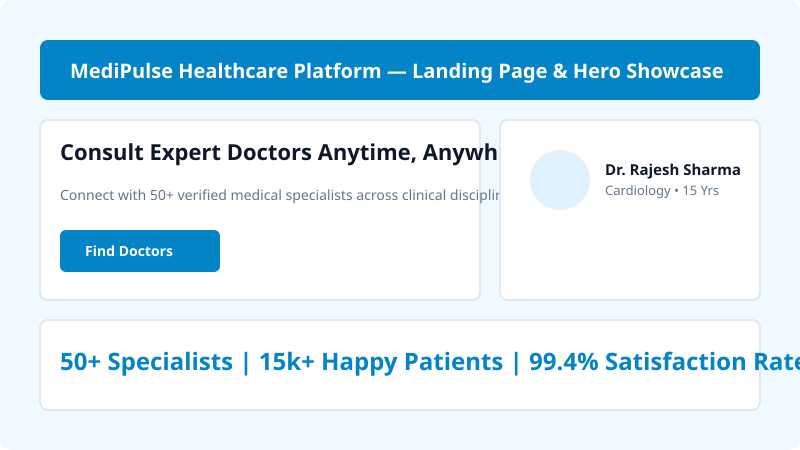
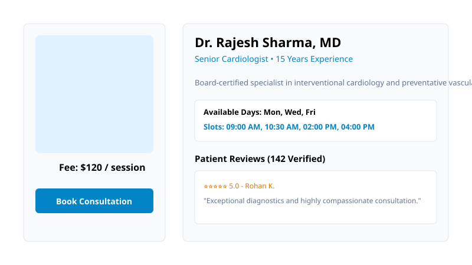
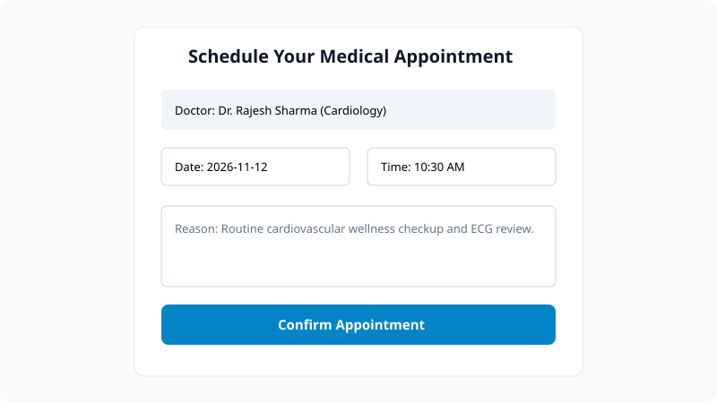
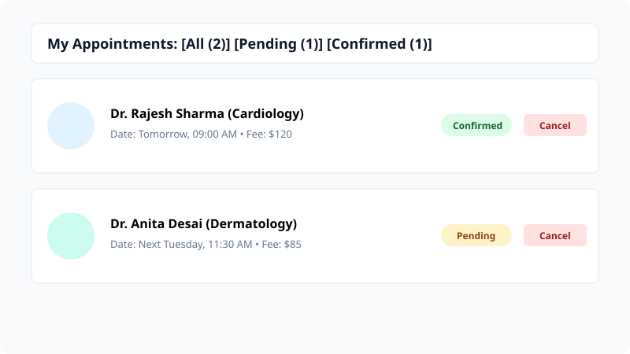
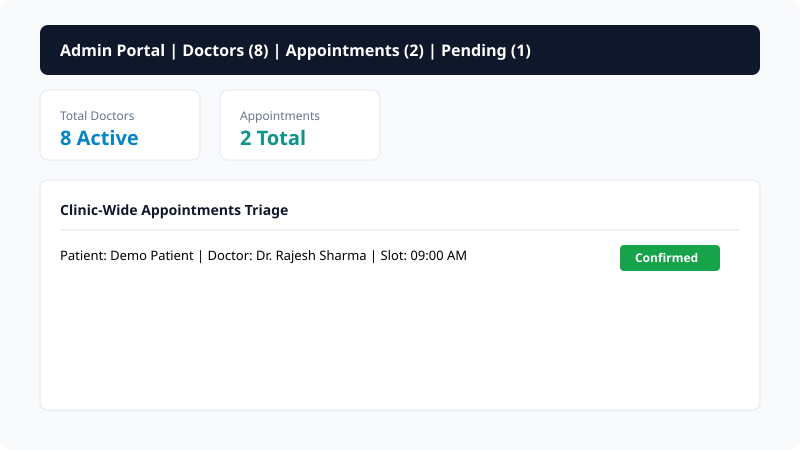

# MediPulse — Smart Healthcare Appointment & Doctor Consultation Platform

A full-stack, production-engineered MERN (MongoDB, Express, React, Node.js) web application designed to streamline doctor appointment scheduling, specialist discovery, patient medical consults, and clinical triage operations.

---

## 2. Project Description

MediPulse bridges the gap between healthcare seekers and verified medical practitioners. Traditional clinic booking suffers from lengthy telephone hold times, lack of upfront fee transparency, and fragmented record-keeping. MediPulse addresses these challenges by delivering an intuitive, responsive, single-page web portal where patients can explore certified physicians across specialties, inspect real-time schedule availability, book consultations in under 30 seconds, and monitor appointment statuses in real-time. 

On the administrative side, clinic managers and hospital staff can oversee appointments across all departments, adjust clinical availability, register new practitioners, and update consultation progression through a secure, role-based dashboard.

---

## 3. Objectives

- **Democratize Healthcare Access**: Enable patients to discover and connect with multi-disciplinary physicians effortlessly from any device.
- **Eliminate Scheduling Bottlenecks**: Provide real-time slot selection and automated booking triage to reduce scheduling conflicts and missed appointments.
- **Ensure Transparent Pricing**: Display upfront consultation fees, qualifications, and patient-verified ratings before booking.
- **Robust Role-Based Security**: Implement strict JWT-based authentication and authorization mechanisms separating standard patient workflows from high-privilege hospital administration.
- **Production-Grade Architecture**: Adhere strictly to industry software design principles including RESTful API conventions, rate limiting, defense-in-depth sanitization, and responsive UI accessibility.

---

## 4. Technologies Used

### Frontend (Client)
- **React.js 18 / 19 (Vite Build Tool)**: Fast, component-driven client architecture.
- **React Router DOM v6 / v7**: Declarative client-side routing with protected route guards and deep-link preservation.
- **Axios**: HTTP client featuring request & response interceptors for JWT injection and automated 401 session recovery.
- **React-Toastify**: Contextual alert and notification system for immediate user feedback.
- **FontAwesome Icons (@fortawesome/react-fontawesome)**: Accessible, lightweight vector icon suite.
- **Custom Modern CSS**: Fluid typography, responsive CSS variables, CSS grid layouts, zero bloated utility frameworks.

### Backend (Server)
- **Node.js**: Asynchronous event-driven JavaScript runtime environment.
- **Express.js**: Fast, minimalist REST API microframework.
- **MongoDB**: Schema-flexible, scalable NoSQL document database.
- **Mongoose ODM**: Object Data Modeling library providing schema enforcement, model validations, and lifecycle hooks.
- **JSON Web Tokens (JWT)**: Cryptographically signed stateless session tokens with 7-day expiration.
- **Bcrypt.js**: Salting and one-way adaptive password hashing.
- **Helmet**: HTTP header hardening against common web vulnerabilities.
- **Express-Rate-Limit**: Brute-force and denial-of-service mitigation for authentication routes.
- **CORS**: Environment-configured Cross-Origin Resource Sharing allowlist.

---

## 5. Features and Functionalities

### Patient & Public Capabilities
- **Landing Page & Medical Showcase**: Engaging hero presentation, value proposition cards, "How It Works" 3-step walkthrough, and live doctor cards.
- **Specialist Directory & Search**: Real-time multi-criteria filtering by medical department (Cardiology, Dermatology, Neurology, Pediatrics, etc.) and keyword search across names and bios.
- **Doctor Profiles & Credentials**: Detailed practitioner biographies, years of experience, consultation fee, days of availability, and patient ratings.
- **Fast Consultation Booking**: Date picker disallowing past dates, dynamic slot picker populated from doctor schedules, and symptom input.
- **Patient Appointment Portal**: Tabbed dashboard (All, Pending, Confirmed, Completed, Cancelled) with status badges and patient-initiated cancellation controls.
- **Authentic Doctor Reviews**: Verified patients can submit 1–5 star ratings and reviews that dynamically update aggregate practitioner ratings.
- **Quick Demo Login Buttons**: One-click autofill buttons for Evaluator and Demo Patient access.

### Administrative Capabilities
- **Administrative Control Panel**: Metric overviews (Total Doctors, Total Appointments, Pending Triage, Confirmed Sessions).
- **Physician Roster Management (CRUD)**: Modal-driven interface to register new doctors, modify schedules/fees, or remove doctors.
- **Hospital Appointment Triage**: System-wide appointment table with status transitions (Confirm, Complete, Cancel).

---

## 6. Folder Structure

```
TRAINING PROJ/
├── client/                     # Frontend Application (React + Vite)
│   ├── public/                 # Static public assets
│   ├── src/
│   │   ├── api/
│   │   │   └── axiosClient.js  # Axios instance with JWT interceptors
│   │   ├── components/         # Reusable UI components
│   │   │   ├── AdminRoute.jsx
│   │   │   ├── DoctorCard.jsx
│   │   │   ├── Footer.jsx
│   │   │   ├── Loader.jsx
│   │   │   ├── Modal.jsx
│   │   │   ├── Navbar.jsx
│   │   │   └── ProtectedRoute.jsx
│   │   ├── context/
│   │   │   └── AuthContext.jsx # Global auth state & persistent session provider
│   │   ├── pages/              # Application views & pages
│   │   │   ├── AdminDashboard.jsx
│   │   │   ├── BookAppointment.jsx
│   │   │   ├── DoctorDetail.jsx
│   │   │   ├── Doctors.jsx
│   │   │   ├── Home.jsx
│   │   │   ├── Login.jsx
│   │   │   ├── MyAppointments.jsx
│   │   │   ├── NotFound.jsx
│   │   │   └── Register.jsx
│   │   ├── App.jsx             # Top-level routing layout
│   │   ├── index.css           # Global theme variables & styling
│   │   └── main.jsx            # React root mounting entrypoint
│   ├── .env.example            # Sample client environment configuration
│   ├── package.json            # Client dependencies and build scripts
│   ├── vercel.json             # Vercel SPA routing rewrite configuration
│   └── vite.config.js          # Vite build & development server config
│
├── server/                     # Backend API (Express + Node + Mongoose)
│   ├── config/
│   │   └── db.js               # MongoDB connection handler
│   ├── controllers/            # Controller business logic
│   │   ├── appointmentController.js
│   │   ├── authController.js
│   │   ├── doctorController.js
│   │   └── reviewController.js
│   ├── middleware/             # Express middlewares
│   │   ├── auth.js             # JWT verification & admin guard
│   │   ├── errorHandler.js     # Centralized 404 & error handlers
│   │   └── rateLimiter.js      # Rate limiting security rule
│   ├── models/                 # Mongoose schema definitions
│   │   ├── Appointment.js
│   │   ├── Doctor.js
│   │   ├── Review.js
│   │   └── User.js
│   ├── routes/                 # Express API routes
│   │   ├── appointmentRoutes.js
│   │   ├── authRoutes.js
│   │   ├── doctorRoutes.js
│   │   ├── healthRoutes.js
│   │   └── reviewRoutes.js
│   ├── .env.example            # Sample server environment configuration
│   ├── index.js                # Express app entrypoint & middleware setup
│   ├── package.json            # Server dependencies and run scripts
│   ├── seed.js                 # Database wipe & demographic seeder script
│   ├── test-e2e.js             # Complete E2E integration test verification
│   └── test-server.js          # In-process API health smoke test
│
├── presentation/               # Academic Presentation Materials
│   ├── generate_pptx.py        # Automated PowerPoint presentation generator
│   └── slides-outline.md       # 10-slide comprehensive presentation script
│
├── .gitignore                  # Root Git ignore rules (node_modules, .env, dist)
├── DEPLOYMENT.md               # Step-by-step Atlas -> Render -> Vercel guide
└── README.md                   # Complete system documentation
```

---

## 7. System Architecture

The following diagram illustrates the unidirectional data flow and decoupled tier separation across the MediPulse platform:

```
[ Web Browser / Client Device ]
               │
               ▼  HTTPS / React Router DOM
   [ React (Vite) Frontend ]
   • AuthContext & ProtectedRoute
   • Axios Interceptor (Bearer JWT)
               │
               ▼  REST API (JSON over HTTPS)
   [ Express.js API Gateway (Node.js) ]
   • Helmet Security Headers & CORS Policy
   • RateLimiter Middleware (Auth Protection)
   • JWT Protect & AdminOnly Role Verification
   • Centralized Error & 404 Handlers
               │
               ▼  Mongoose ODM (Schema & Validation)
   [ MongoDB Atlas Cloud Database ]
   ├── Users Collection (Bcrypt Passwords)
   ├── Doctors Collection
   ├── Appointments Collection
   └── Reviews Collection
```

---

## 8. Database Design

### Collections, Schema Fields, and Relationships

```
┌─────────────────────────────────┐           ┌─────────────────────────────────┐
│              User               │           │             Doctor              │
├─────────────────────────────────┤           ├─────────────────────────────────┤
│ _id: ObjectId                   │           │ _id: ObjectId                   │
│ name: String                    │           │ name: String                    │
│ email: String [unique, lower]   │           │ specialization: String          │
│ password: String [bcrypt hash]  │           │ experienceYears: Number         │
│ role: "user" | "admin"          │           │ fees: Number                    │
│ createdAt: Date                 │           │ availability: { days, slots }   │
│ updatedAt: Date                 │           │ image: String [URL]             │
└───────────────┬─────────────────┘           │ bio: String                     │
                │ 1                           │ rating: Number                  │
                │                             │ reviewsCount: Number            │
                │                             │ isAvailable: Boolean            │
                │                             │ createdAt: Date                 │
                │                             └────────────────┬────────────────┘
                │                                              │ 1
                │                                              │
                │ M                                            │ M
        ┌───────┴──────────────────────────────────────────────┴───────┐
        │                         Appointment                          │
        ├──────────────────────────────────────────────────────────────┤
        │ _id: ObjectId                                                │
        │ user: ObjectId ────► Ref: User                               │
        │ doctor: ObjectId ──► Ref: Doctor                             │
        │ date: String (YYYY-MM-DD)                                    │
        │ timeSlot: String (e.g. "09:00 AM")                           │
        │ reason: String                                               │
        │ status: "pending" | "confirmed" | "cancelled" | "completed"  │
        │ createdAt: Date                                              │
        │ updatedAt: Date                                              │
        └──────────────────────────────────────────────────────────────┘
```

#### Secondary Collection: `Review`
- `_id`: ObjectId
- `user`: ObjectId (Ref: `User`, required)
- `doctor`: ObjectId (Ref: `Doctor`, required)
- `rating`: Number (1 to 5, required)
- `comment`: String (required)
- `timestamps`: `createdAt`, `updatedAt`
- *Constraint*: Compound unique index `{ user: 1, doctor: 1 }` prevents duplicate spam reviews from the same patient.

---

## 9. API Endpoints Table

| Method | Endpoint | Auth Required | Role | Description |
| :--- | :--- | :--- | :--- | :--- |
| **GET** | `/api/health` | No | Public | Returns service uptime and server status timestamp |
| **POST** | `/api/auth/register` | No | Public | Registers a new patient account (rate-limited) |
| **POST** | `/api/auth/login` | No | Public | Authenticates credentials and issues 7-day JWT token |
| **GET** | `/api/auth/me` | Yes | User / Admin | Returns authenticated user profile |
| **GET** | `/api/doctors` | No | Public | Fetches all doctors (supports `?search=` and `?specialization=`) |
| **GET** | `/api/doctors/:id` | No | Public | Fetches detailed profile of a single doctor |
| **POST** | `/api/doctors` | Yes | Admin Only | Creates a new medical specialist profile |
| **PUT** | `/api/doctors/:id` | Yes | Admin Only | Updates an existing doctor's details, fee, or schedule |
| **DELETE**| `/api/doctors/:id` | Yes | Admin Only | Removes a doctor from the hospital roster |
| **POST** | `/api/appointments` | Yes | User | Books a consultation slot for a selected physician |
| **GET** | `/api/appointments/mine`| Yes | User | Retrieves all consultation bookings owned by current patient |
| **GET** | `/api/appointments` | Yes | Admin Only | Retrieves all clinic appointments across all patients |
| **PUT** | `/api/appointments/:id/status` | Yes | User / Admin | Admin updates status; Patient can cancel own pending booking |
| **DELETE**| `/api/appointments/:id` | Yes | User / Admin | Deletes an appointment record |
| **GET** | `/api/reviews/doctor/:id` | No | Public | Fetches all patient feedback reviews for a doctor |
| **POST** | `/api/reviews` | Yes | User | Submits or updates a review and recalculates doctor rating |
| **DELETE**| `/api/reviews/:id` | Yes | User / Admin | Deletes a review and updates aggregate practitioner rating |

---

## 10. Installation and Execution Steps

### Prerequisites
- Node.js (v18.x or newer, v20+ recommended)
- MongoDB running locally or a free cloud MongoDB Atlas cluster URI
- Git

### 1. Clone & Setup Monorepo
```bash
git clone https://github.com/yashwantreddy06/medipulse-hms.git
cd "TRAINING PROJ"
```

### 2. Configure Backend (`server/`)
```bash
cd server
npm install

# Copy environment template
cp .env.example .env
```

Edit `server/.env`:
```env
PORT=5000
MONGO_URI=mongodb://127.0.0.1:27017/medipulse
JWT_SECRET=medipulse_jwt_secret_dev_key_2026_xyz987
CLIENT_URL=http://localhost:5173
NODE_ENV=development
```

### 3. Populate Demo Database
Execute the database seed script to wipe old records and generate sample doctors, appointments, and credentials:
```bash
npm run seed
```

### 4. Start Backend Server
```bash
npm run dev
# or for standard execution:
npm start
```
The API server will listen on `http://localhost:5000` (Health check at `http://localhost:5000/api/health`).

### 5. Configure & Start Frontend (`client/`)
In a new terminal window:
```bash
cd client
npm install

# Copy environment template
cp .env.example .env
```

Ensure `client/.env` contains:
```env
VITE_API_URL=http://localhost:5000/api
```

Start the Vite development server:
```bash
npm run dev
```
Open `http://localhost:5173` in your browser.

---

## 11. Deployment Links

- **Frontend Application (Vercel)**: `https://medipulse-hms.vercel.app` *(Placeholder / To be finalized upon student repository push)*
- **Backend API Service (Render)**: `https://medipulse-api.onrender.com` *(Placeholder / To be finalized upon student repository push)*

*(Refer to [`DEPLOYMENT.md`](./DEPLOYMENT.md) for full step-by-step cloud deployment instructions).*

---

## 12. Demo Credentials

Populated automatically by the `npm run seed` command:

| Role | Email | Password | Permissions |
| :--- | :--- | :--- | :--- |
| **System Admin** | `admin@medipulse.com` | `AdminPassword123` | Full Access: Manage Doctors, Update Appointment Statuses |
| **Demo Patient** | `patient@medipulse.com` | `PatientPass123` | Standard: Book Appointments, Cancel Own, Post Reviews |

*Note: The Login page includes one-click demo auto-fill buttons for both roles for rapid testing.*

---

## 13. Team Members

- **Team Name**: Apex Innovators
- **Members**:
  1. **Yashwant Reddy** — Reg No. `21BCE1042` (Full-Stack Architecture & Backend API)
  2. **Priya Sharma** — Reg No. `21BCE1189` (Frontend Development & State Management)
  3. **Rahul Varma** — Reg No. `21BCE1254` (Database Modeling & Testing)

---

## 14. Screenshots

*(Drop screenshots here prior to final grading submission)*

### 1. Landing Page & Hero Showcase

*Alt: MediPulse Hero banner featuring instant doctor booking call-to-action and clinical statistics.*

### 2. Specialist Doctor Directory with Filters

*Alt: Doctor catalog with specialization filter pills and search bar.*

### 3. Physician Detail & Patient Reviews

*Alt: Doctor credentials profile with verified badge, schedule slots, and patient feedback list.*

### 4. Appointment Booking Form

*Alt: Appointment scheduler with date picker, slot selector, and symptom input.*

### 5. Patient Appointment Management Dashboard

*Alt: Tabbed patient appointments view with status badges and cancellation actions.*

### 6. Administrative Operations Portal

*Alt: Admin dashboard displaying doctor CRUD modal and clinic-wide appointment status controls.*

---

## 15. Future Scope

- **Telehealth Video Consultations**: Integration with WebRTC / Twilio for in-browser real-time video consults.
- **Payment Gateway Integration**: Adding Stripe or Razorpay for instant online prepayment of consultation fees.
- **Automated Reminders**: SMS and WhatsApp appointment reminders powered by Twilio / WhatsApp Business API.
- **Prescription & Diagnostic Uploads**: Secure digital health record storage using AWS S3 or Google Cloud Storage.
- **AI Medical Assistant**: Clinical symptom pre-screener powered by Google Gemini API to recommend appropriate medical specialties.

---

## 16. License

This project is licensed under the MIT License — authored and maintained by Team Apex Innovators. See the [LICENSE](./LICENSE) file for complete details.

